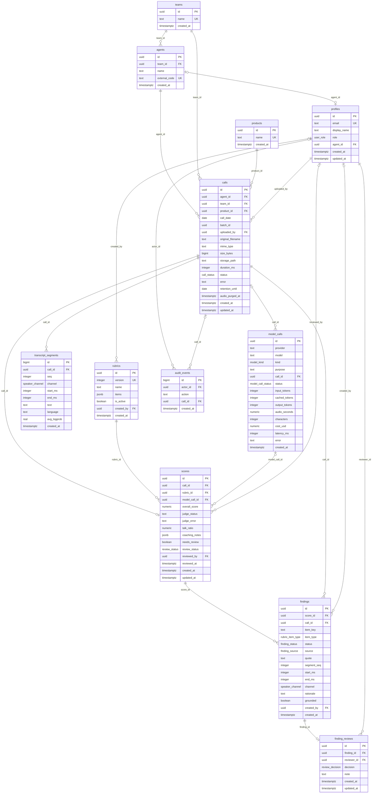

# ERD: Sales Call Compliance

Generated by docs/design/tools/gen_model.py.

## Relationships

- Each `agents` row belongs to exactly one `teams` through `team_id`; a `teams` row has many `agents` rows.
- Each `profiles` row optionally belongs to `agents` through `agent_id`; a `agents` row has at most one `profiles` rows.
- Each `rubrics` row optionally belongs to `profiles` through `created_by`; a `profiles` row has many `rubrics` rows.
- Each `calls` row belongs to exactly one `agents` through `agent_id`; a `agents` row has many `calls` rows.
- Each `calls` row belongs to exactly one `teams` through `team_id`; a `teams` row has many `calls` rows.
- Each `calls` row belongs to exactly one `products` through `product_id`; a `products` row has many `calls` rows.
- Each `calls` row belongs to exactly one `profiles` through `uploaded_by`; a `profiles` row has many `calls` rows.
- Each `transcript_segments` row belongs to exactly one `calls` through `call_id`; a `calls` row has many `transcript_segments` rows.
- Each `model_calls` row optionally belongs to `calls` through `call_id`; a `calls` row has many `model_calls` rows.
- Each `scores` row belongs to exactly one `calls` through `call_id`; a `calls` row has at most one `scores` rows.
- Each `scores` row belongs to exactly one `rubrics` through `rubric_id`; a `rubrics` row has many `scores` rows.
- Each `scores` row optionally belongs to `model_calls` through `model_call_id`; a `model_calls` row has many `scores` rows.
- Each `scores` row optionally belongs to `profiles` through `reviewed_by`; a `profiles` row has many `scores` rows.
- Each `findings` row belongs to exactly one `scores` through `score_id`; a `scores` row has many `findings` rows.
- Each `findings` row belongs to exactly one `calls` through `call_id`; a `calls` row has many `findings` rows.
- Each `findings` row optionally belongs to `profiles` through `created_by`; a `profiles` row has many `findings` rows.
- Each `finding_reviews` row belongs to exactly one `findings` through `finding_id`; a `findings` row has at most one `finding_reviews` rows.
- Each `finding_reviews` row belongs to exactly one `profiles` through `reviewer_id`; a `profiles` row has many `finding_reviews` rows.
- Each `audit_events` row optionally belongs to `profiles` through `actor_id`; a `profiles` row has many `audit_events` rows.
- Each `audit_events` row optionally belongs to `calls` through `call_id`; a `calls` row has many `audit_events` rows.
