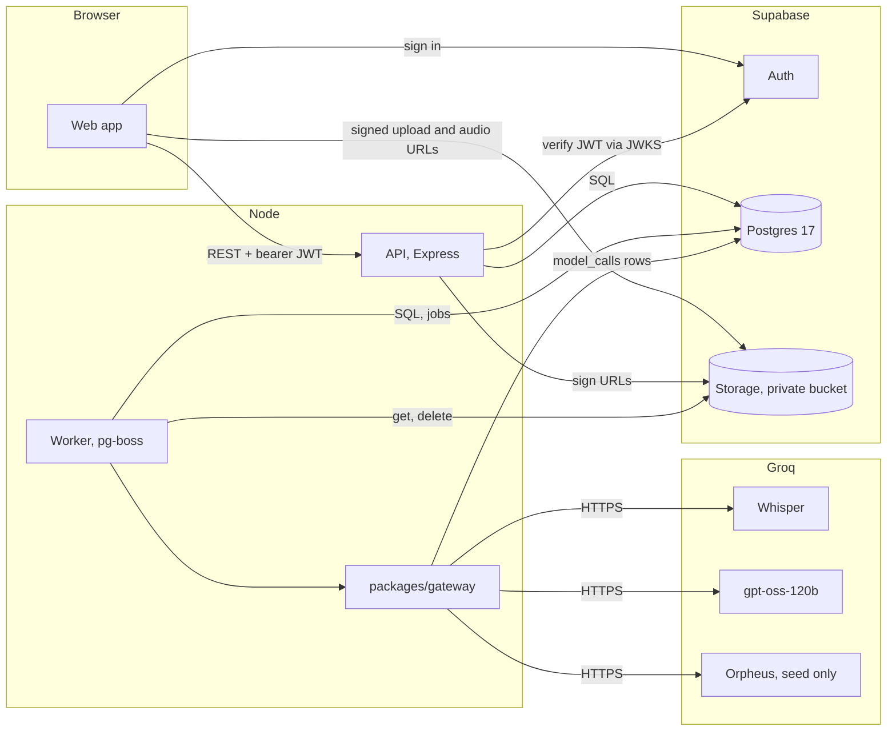

# High Level Design: Latte (sales call compliance and coaching)

- Task: SCC-1
- Author: unattributed, 2026-10-14
- Status: Reviewed
- Version: v1 (review findings applied the same day)
- PRD: docs/product/PRD.md
- ADRs: docs/architecture/decisions.md
- Tenets: docs/architecture/tenets.md

Serves: REQ-001 to REQ-036; US-00-001, US-00-002, US-00-003, US-01-001 to US-01-008, US-02-001, US-02-002, US-02-003; ADR-0001 to ADR-0009.

## Summary

One TypeScript monorepo holds a React web app, an Express API and a pg-boss worker on a hosted Supabase project; the browser uploads recordings straight to a private bucket, the worker transcribes each stereo channel with Groq Whisper and scores the transcript with one Groq gpt-oss-120b call, and every model call passes one budgeted gateway. A rule net runs on every transcript before and independently of the judge, findings take their quotes and times from transcript segments in code, and any call whose judge fails still reaches QA as unscored, so a prohibited statement reaches a human even when the model misses it; the eval gate fails any judge miss on planted breaches.

Diagram: docs/architecture/diagrams/SalesCall_SystemArchitecture_v1.svg

## What gets built

| Component | Kind | Stack | Responsibility | Repository |
| --- | --- | --- | --- | --- |
| Web app | SPA | React 19, Vite, TanStack Router and Query, coss ui, supabase-js | Sign-in, direct upload, call list and detail with player, review queue, scorecard, rubric, dashboard | SalesCallPlatform |
| API | HTTP service | Node 24, Express 5, Zod, Drizzle, pino, jose | Auth check, roles, signed upload and audio URLs, reads, review writes, reference data | SalesCallPlatform |
| Worker | Background process, or on Vercel a queue consumer function | Node 24, the job port (Vercel Queues on Vercel, pg-boss elsewhere, ADR-0032), gateway, audio module | Transcribe, score, purge jobs | SalesCallPlatform |
| Model gateway | Shared package (packages/gateway) | TypeScript, fetch to OpenAI-compatible endpoints | Every model call: budget, max_tokens cap, cost log, rate limits, replay | SalesCallPlatform |
| Eval harness | CLI | TypeScript | Seed rendering, judge replay, per-item agreement, false-negative gate | SalesCallPlatform |
| Supabase project | Managed platform | Postgres 17, Auth, Storage | Data, identities, recordings | existing: hosted Supabase project yzgzxtwfusvgpaphuupo |

## 1. Goal and non-goals

The system audits every uploaded sales or service call: it transcribes the agent and customer channels, scores the transcript against a configurable compliance and quality rubric, and sends risky calls to QA with timestamped, playable evidence. QA reviewers confirm or reject each finding, and the system measures judge-to-human agreement per rubric item, while agents see a scorecard and their top three coaching points. Model cost is bounded by one gateway with a monthly budget, and a CI eval gate fails whenever the judge misses a planted prohibited statement.

Agreed: through the plan approved in the session of 2026-10-14.

Non-goals:
- Live monitoring of calls in progress (PRD non-goal).
- Dialler or telephony integration; recordings arrive by upload only (PRD non-goal).
- Objection-handling and interruption scoring (PRD non-goal).
- Diarisation; stereo channels identify speakers (REQ-005).
- Automatic re-scoring of past calls when the rubric changes (Q-006).
- User administration screens; users are created in Supabase Auth and given a role by a seed script (US-00-003).

## 2. Users and flows

Actors: QA reviewer, sales agent, manager, worker (system).

Flow A, upload to queue (US-01-001, US-01-002, US-01-003, US-01-005):
1. QA reviewer or manager picks 1 to 10 WAV or MP3 files in the web app and fills agent, team, product and date per file from reference lists (GET /api/reference).
2. Per file, the API checks role, type and size (50 MB, the Supabase per-file cap) and returns a signed upload URL; the browser uploads the file directly to the private bucket.
3. The browser calls confirm; the API checks the object exists, then inserts the call row "uploaded" and enqueues a transcribe job in one transaction.
4. Worker claims the call with a conditional status update (uploaded to transcribing, carrying the job id), downloads the file, decodes it, refuses mono, splits left (agent) and right (customer), trims silence, transcribes each channel through the gateway, maps times back, saves segments, sets "transcribed" and enqueues score.
5. Worker claims scoring the same way, runs the rule net on the segments and computes talk ratio first, then makes one gateway chat call that returns, per rubric item, a status and the segment numbers that evidence it; code copies quotes and times from those segments. If the judge fails (invalid output, budget, provider), the score is saved as unscored with the rule findings and the call goes to QA.
6. needs_review is set when any prohibited finding (judge or rule), any missed mandatory item, any ungrounded citation or a failed judge exists; the call appears in the QA queue.

Flow B, review (US-01-006, US-01-007):
1. QA reviewer opens a queued call; the API returns transcript, findings and a signed audio URL valid 10 minutes, and writes an audit event.
2. Reviewer clicks a finding; the player seeks to the segment start.
3. Reviewer marks agree or disagree, or adds a missed finding; then completes the review.
4. Agreement per rubric item is computed on read from the review rows.

Flow C, coaching (US-00-001, US-00-002):
1. Agent signs in and lands on their scorecard, computed from their own scored calls, excluding findings QA disagreed with (Q-011).
2. Top three coaching points are the three items with most misses or breaches in the last 90 days; each call shows the judge's notes.

Late arrival: a call whose transcription would pass the monthly budget fails with "budget exhausted" and shows Retry; one whose judge would pass it is queued for QA as unscored with its rule findings.

## 3. Architecture

Web app: React SPA. Signs in with Supabase Auth (publishable key), calls the API with the access token, uploads to and plays from signed Storage URLs. Holds no secrets. Owner: frontend.

API: Express 5 service. Verifies the bearer token against the project JWKS (ADR-0003), loads the profile and role, validates every input with shared Zod schemas, issues signed upload and audio URLs after role and ownership checks, writes calls and reviews, enqueues jobs, audits recording access. Talks to Postgres through the session pooler and to Storage with the secret key. Owner: backend.

Worker: consumes the transcribe and score topics through the job port (ADR-0032), never a queue library directly. On Vercel the platform pushes each message to a consumer function, with an optional concurrency cap per topic and a minute sweep that republishes calls whose publish was lost; elsewhere a separate Node process consumes pg-boss queues transcribe, score and purge (ADR-0004). Writes calls, segments, scores and findings. Uses the audio module and the gateway. When the gateway's limiter says wait, the job reschedules itself with startAfter and returns instead of sleeping, so no job outlives its lease. Owner: backend.

Model gateway: workspace package used by the worker and the eval harness; one function `callModel` for chat, transcription and speech (REQ-022). Applies the max_tokens cap, the monthly USD budget check against model_calls, a limiter per model, retries on 5xx within one attempt, cost computation, and replay or record of responses keyed by request hash (ADR-0006, ADR-0007, ADR-0009). Owner: backend.

Eval harness: CLI scripts in evals/: render seed audio, run the judge in replay or record mode over 20 labelled calls (one of them about 20 minutes long), print per-item agreement and fail the gate on a missed planted prohibited statement.

**Risks this leaves open**
- The budget check and the spend are not atomic: with P worker processes at concurrency C, overshoot is at most P x C x the cost of one model call (about USD 0.01 at the defaults).
- One Supabase project hosts data, auth and files; an outage there stops everything.

## 4. Data

Entities (full model in docs/design/data-model.md): profiles, teams, products, agents, rubrics (versioned), calls, transcript_segments, scores, findings, finding_reviews, model_calls, audit_events; pg-boss owns its own schema. All in Supabase Postgres 17, written by the API and the worker only. Migrations are SQL files applied in order by a migrate script; RLS is enabled with no anon or authenticated policies on every app table (ADR-0003).

Growth, assumption: 20,000 calls a month of 6 minutes: about 100 segments per call is 2M segment rows a month; about 12 findings per call is 240K rows; about 3 model_calls per call is 60K rows. Recordings: a 6-minute stereo MP3 at 128 kbps is about 5.8 MB, so about 116 GB a month; with 90-day audio retention (Q-004) about 350 GB held.

Retention: audio purged after 90 days by the purge job (Q-004, assumption); every other table UNDEFINED (Q-009).

**Risks this leaves open**
- Transcripts are personal data with no decided lifetime and no way to find one customer's calls for erasure (Q-009).
- 2M segment rows a month pass 10^7 within the first half year at full volume; partitioning is not planned.

## 5. Interfaces

- REST API v1 under /api, contract api/openapi.yaml (new): uploads (sign, confirm), calls (list, get, audio URL, retry failed), review (queue, decisions, missed findings, complete), scorecard and coaching, agreement, dashboard, rubrics, usage, reference, me, health.
- Shared schemas: packages/shared (new), the Zod source of request and response shapes and of the judge output schema.
- Jobs: topics transcribe {v, callId}, score {v, callId}, purge {} behind the job port (ADR-0032); payloads carry ids and a version only; workers re-read rows (tenet 6).
- Groq OpenAI-compatible endpoints: /chat/completions, /audio/transcriptions, /audio/speech.

## 6. External integrations

Supabase (Auth, Postgres, Storage). Used for identities, all data and recordings. Plan, assumption: free tier, which caps each stored file at 50 MB. Down: sign-in fails and the API answers 503 on readiness; queued jobs wait in Postgres and resume. Slow: API requests time out at 10 s; uploads go browser to Storage and are not bound by that timeout. Credentials: secret key and database password in the server `.env` only, rotated in the Supabase dashboard by the project owner; a leaked secret key gives full data access, so rotation is immediate.

Groq (Whisper, gpt-oss-120b, Orpheus). Used for transcription, judging and seed audio. Down or 5xx: the job is retried by the queue system with exponential backoff (5 attempts, from 30 s doubling); transcription then fails the call with Retry, judging falls back to unscored-in-QA. Rate limited (429 or limiter says wait): the job reschedules after retry-after. Credential: GROQ_API_KEY in the server `.env`, rotated in the Groq console; a leak lets someone spend on the account but not read our data.

### Deliberately not integrated

- A guard model (Llama Prompt Guard or gpt-oss-safeguard): the spec allows one model call per call for scoring; injection is handled structurally (Q-005).
- Local speech models (faster-whisper, Piper): rejected by the user, TypeScript only (ADR-0005, ADR-0007).
- OpenRouter and Gemini for transcription: they return no segment timestamps (ADR-0009, Q-010); they remain chat options by configuration.
- Error tracking SaaS (Sentry): stdout logs are enough for the first release.

**Risks this leaves open**
- Recordings leave our boundary for Groq; Groq's retention terms and India's DPDP Act obligations for customer audio are not reviewed here (privacy-review).
- No second STT vendor is built; a long Groq outage stops new transcription.

## 7. Failure modes

| Component | What fails | How it is noticed | What the user sees | How it recovers |
| --- | --- | --- | --- | --- |
| Web app | Session expires | 401 from API | Redirect to sign-in | Sign in again |
| Web app | Direct upload fails mid-file | upload promise rejects | File marked failed in the batch list | User retries that file; no call row exists until confirm |
| API | Supabase JWKS unreachable | JWT verify error logged, 503 count | "Service unavailable, try again" | jose caches keys; recovers when reachable |
| API | Object uploaded, confirm never called | none at the time | Nothing | Purge job deletes objects with no call row older than 1 day |
| Worker | Crash mid-transcribe | lease expiry (pg-boss) or visibility timeout (Vercel Queues), then redelivery | Call stays "transcribing" | Retry re-claims only if the stored job id is its own or expired; segments rewritten in one transaction |
| Worker | Groq 429 or limiter wait | model_calls status, warn log | Call takes longer | Job reschedules with startAfter, never sleeps past its expiry |
| Worker | Groq 5xx past retries during transcription | job dead-lettered | Call failed with reason and Retry | QA retries |
| Worker | Judge output invalid, truncated, refused by budget or provider down | judge_status failed | Call in QA queue marked "unscored" with rule findings | Reviewer reviews by hand; Retry scoring when fixed |
| Worker | Model cites a segment number that does not exist | grounded false | Finding marked "not grounded", call in QA queue | Human review |
| Gateway | Concurrent processes pass the budget check | usage total slightly above budget | Nothing | Accepted overshoot, bounded as in section 3 |
| Eval gate | Missed planted prohibited statement | make eval exits 1 | CI red with call and item | Fix prompt or model, re-record |
| Purge job | Storage delete fails | error log | Nothing | Retried on the next daily run |
| Supabase | Postgres down | readiness 503 | "Service unavailable" | Managed recovery; jobs resume |

Check then act: the budget is read immediately before each request, not at enqueue; jobs re-read the call status and active rubric at run time. Side effect then record: a provider call that succeeds and whose model_calls insert then fails is a lost cost row; the gateway logs it at error level and accepts that loss.

## 8. Scaling and limits

Load, assumption: 20,000 calls a month, 6 minutes each, over 22 working days of 8 hours: about 910 calls a day, 114 an hour on average. Worst window, assumption: half a day's calls uploaded in the last 2 hours: about 455 calls in 2 hours.

Audio per call after silence trimming: each channel keeps only its speaker, so about 360 audio seconds per call, plus the 10-second billing minimum on short chunks.

Judge tokens, assumption until the spike measures it: about 3,000 input; output is statuses and segment numbers plus three short notes, about 400 tokens plus low-effort reasoning, inside the 1,000 cap.

First bottleneck: Groq base limits. Whisper allows 7,200 audio seconds an hour and 28,800 a day: 20 calls an hour and 80 a day. gpt-oss-120b allows 8K tokens a minute and 200K a day at about 4,000 tokens a call: 2 calls a minute and 50 a day. At base limits the design stops at about 50 scored calls a day; the use case needs 910. Decision needed from the product owner: a Groq plan with at least 20x the base daily limits (ADR needed: Groq plan for production volume), or accept pilot volume only.

QA load, assumption: one missed mandatory item flags a call, so most calls may queue; at 910 a day and 3 minutes a review that is about 45 reviewer-hours a day. B2 ("within a day") depends on reviewer headcount as much as on Groq.

Cost per call: Whisper large v3 at $0.111 an hour for 360 s is $0.011; judge 3,000 input at $0.15/M plus 1,000 output at $0.60/M is $0.001; about $0.012 a call, about $245 a month for 20,000 calls. The default monthly budget of USD 5 covers about 400 calls and suits development (Q-003).

Connections: the API and the worker each run a pool of at most 5 plus pg-boss's own pool of at most 4: 18 connections, under the session pooler's default of 15 per user on the smallest compute only if pools are kept at 3, 3 and 2; the configured maxima are set to fit the plan's pool size (assumption: read it from the dashboard before pilot).

Parallelism: the limiter is per process; with N worker processes each is configured to the plan limit divided by N.

**Risks this leaves open**
- At base Groq limits the worst window takes about 9 days to clear for scoring.
- The token estimate is untested on long or Hinglish calls; the eval set includes one 20-minute call to measure it.

## 9. Security and privacy

Auth: Supabase Auth email and password; the API verifies tokens against the JWKS URL and maps the subject to profiles.role (ADR-0003). Authorisation per resource: agents read only calls whose agent is linked to their profile, enforced in the SQL predicate (tenet 4); QA and managers read all calls; uploads by QA and managers (Q-002); rubric writes by managers (Q-006). Recordings: private bucket; signed upload URLs per file; signed playback URLs for 10 minutes issued only after the ownership check, each written to audit_events (US-02-003). RLS with no policies blocks the publishable key from app tables. PII touched: customer voice, spoken names, policy details, agent names. Secrets: SUPABASE_SECRET_KEY, DATABASE_URL, GROQ_API_KEY, server side only, from `.env` (gitignored); the web build receives only the URL and publishable key (tenet 7). Logs carry ids, never transcript text or keys. Prompt injection: transcript is delimited data, output schema is strict and carries no free-text quotes, no tools.

**Risks this leaves open**
- Signed URLs are bearer links for their lifetime; one forwarded in that window plays for anyone.
- One Supabase project serves development, evals and pilot; its secret key sits in developers' `.env` files. Production needs its own project (open question, section 17).

## 10. Observability

Logs: pino JSON to stdout with request id, user id, call id, job id; no PII text. Metrics: job durations and outcomes, model_calls aggregates (cost per month, tokens, 429 count) via /api/usage and the manager page. Traces: none in the first release. Alerts, assumption (no alerting stack yet): failed calls above 5% in an hour, budget above 80%, dead-letter queue non-empty, unscored calls above 5%; each documented in docs/runbooks/sales-call-operations.md.

**Risks this leaves open**
- Without an alerting stack the alerts are checks an operator runs, not pages.

## 11. Analytics

No product analytics events in the first release. Business questions are answered by SQL over domain tables: flag rate by team and product (scores, calls), judge agreement per item (finding_reviews, findings), spend (model_calls). The audit trail (audit_events) is kept apart. ADR needed: none, no analytics store.

**Risks this leaves open**
- Dashboard queries run on the primary database; long date ranges over millions of segment rows could slow the API.

## 12. Rollout and rollback

Phase 1, development: seeded users, reference data and the 20 synthetic calls; monthly budget USD 5. Phase 2, pilot: real recordings from one team on a separate Supabase project, QA reviewing every call. Phase 3, full volume after the Groq plan decision. Migration order: schema migrations run before the new API and worker start; migrations are additive within a phase. Back out: stop the worker (jobs stay queued in Postgres), redeploy the previous build; additive columns are ignored by the older build. In-flight work at cutover: queued jobs run on the new worker; a job claimed by an old worker expires and is re-claimed.

**Risks this leaves open**
- A rubric edit mid-pilot changes scoring for new calls only; comparisons across the edit need the rubric version filter.

## 13. Outside the standard stack

- Express 5 (ADR-0002): needs Architect or Engineering Manager sign-off; pending.
- Supabase hosted Auth and Storage (ADR-0003): needs sign-off; pending.
- pg-boss (ADR-0004): needs sign-off; pending.
- Groq Whisper, gpt-oss-120b, Orpheus (ADR-0006, ADR-0007, ADR-0009): needs sign-off; pending.
- coss ui (ADR-0008): needs sign-off; pending.

## 14. Repository plan

| Repository | Path | Stack id | Responsibility | Apps |
| --- | --- | --- | --- | --- |
| SalesCallPlatform | SalesCall/Server/SalesCallPlatform | node-api | The monorepo: API, worker, gateway, shared schemas, web app, evals | apps/api (API and worker), apps/web (Web app) |

## 15. Decisions and conflicts

9 ADRs indexed (ADR-0005 superseded by ADR-0009) and 2 conflicts settled in docs/architecture/decisions.md. ADRs needed: Groq plan for production volume.

## 16. What the review found

Reviewed by: critic, 2026-10-14

### MAJOR: The rule net can be skipped, so a prohibited statement can miss QA
The rule net ran only after the judge output passed validation; invalid output and budget exhaustion sent the call to failed, not QA.
Conflicts with: Summary, Flow A step 4, Section 7, Tenet 3, REQ-017, US-01-005 AC-1
Fix: Run the rule net before and independently of the judge; route a call whose judge failed to QA as unscored.
Status: fixed (Summary, section 2 Flow A steps 5 and 6, section 7, data model scores.judge_status)

### MAJOR: The 1000-token cap includes reasoning, and the output schema may not fit
About 12 findings with quotes and notes plus reasoning tokens may truncate inside 1000 tokens.
Conflicts with: Section 8, ADR-0006, REQ-024, US-01-003 AC-2
Fix: Model emits segment numbers and status codes only; code copies quotes and times; cap note length; add a 20-minute call to the eval set.
Status: fixed (section 2 Flow A step 5, section 8 judge tokens, section 3 eval harness)

### MAJOR: Rate-limit waits can expire jobs, causing duplicate runs and double spend
A limiter sleeping inside a job can outlive pg-boss expiry and run twice; the overshoot bound ignored concurrency.
Conflicts with: Section 3, Section 7, Section 8, ADR-0004
Fix: Reschedule with startAfter instead of sleeping; claim each call with a conditional status update carrying the job id; restate the overshoot bound.
Status: fixed (section 3 Worker and risks, section 2 Flow A step 4, section 7)

### MAJOR: The upload path cannot carry 10 x 100 MB
Streaming the batch through Express conflicts with the 10 s timeout and the Supabase free plan's 50 MB file cap.
Conflicts with: Flow A step 2, Section 6, Section 7, Q-001, US-01-001 AC-3
Fix: Signed upload URLs per file, browser uploads directly, confirm call inserts the row and the job; record the plan.
Status: fixed (section 2 Flow A steps 2 and 3, section 6, section 7, Q-001 and AC-US-01-001-3 now 50 MB)

### MAJOR: The STT provider is marked cheap to reverse, but it is not
OpenRouter and Gemini return no segment timestamps; the time map and grounding depend on them.
Conflicts with: ADR-0005, Section 6, REQ-023
Fix: Mark it awkward, name a second vendor, scope REQ-023 to chat.
Status: fixed (ADR-0009 supersedes ADR-0005; Q-010; section 6)

### MINOR: One Supabase project serves dev, eval, pilot and production
The secret key for a project that will hold real customer audio sits in developers' `.env` files, and eval spend shares the budget.
Conflicts with: Section 9, Section 12
Fix: A separate project for pilot and production; budget per environment.
Status: fixed (section 12 pilot on a separate project; section 9 risk; section 17 question)

### MINOR: "Exactly one chat call" conflicts with retries and with the rescore endpoint
Retries each log a model_calls row, and the rescore endpoint had no story.
Conflicts with: US-01-003 AC-1, Section 5
Fix: Count the successful scoring call per score; remove rescore or give it a story.
Status: fixed (AC-US-01-003-1 counts the successful call tied to the score; rescore replaced by retry of failed calls under AC-US-01-002-5)

### MINOR: The budget has no period, and reference data has no endpoint
A lifetime budget stops production once passed; the upload form needs agents, teams and products from somewhere.
Conflicts with: REQ-026, Section 5, US-01-001
Fix: A monthly budget window; GET /api/reference plus a seed script.
Status: fixed (monthly budget window, section 1 and 7; GET /api/reference and seed script, sections 2 and 5)

### NIT: Status and placement
Status read Reviewed before review; the worker writes too; evals import the gateway.
Conflicts with: Header, ADR-0003, repository layout
Fix: Set status after review; note worker writes; move the gateway to packages/gateway.
Status: fixed (worker writes noted in section 4; gateway is packages/gateway; status set after the review)

Weakest claims the review raised, and the experiment each needs: Hinglish and Devanagari output vs English-only phrase rules (spike: transcribe Hinglish clips and grep; the rule net gets Devanagari and romanised patterns); tokens per call (spike: score one 6-minute and one 20-minute transcript live, read usage and finish_reason); connection pool (read the pool size before pilot, section 8).

## 17. Open questions and assumptions

- Groq plan for production volume (section 8). Owner: product owner (requester), by 2026-10-31.
- QA reviewer headcount for the expected queue size (section 8). Owner: product owner, by 2026-10-31.
- Separate Supabase project for pilot and production (section 9). Owner: product owner, by 2026-10-31.
- Groq data retention terms and DPDP Act obligations for customer audio (section 6). Owner: compliance lead, by 2026-10-31.
- Retention of transcripts and other rows, and customer erasure (Q-009). Owner: compliance lead, by 2026-10-31.
- Hosting region for API and worker relative to ap-south-1. Owner: engineering, by 2026-10-31.
- assumption: 6-minute average call and end-of-day upload peak (section 8). Owner: product owner, by 2026-10-31.
- assumption: Supabase free plan and its pool size (sections 6 and 8). Owner: product owner, by 2026-10-31.
- assumption: no alerting stack (section 10). Owner: engineering, by 2026-10-31.
